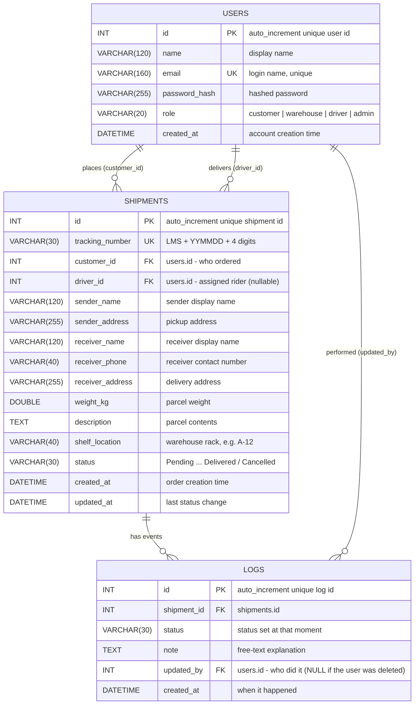
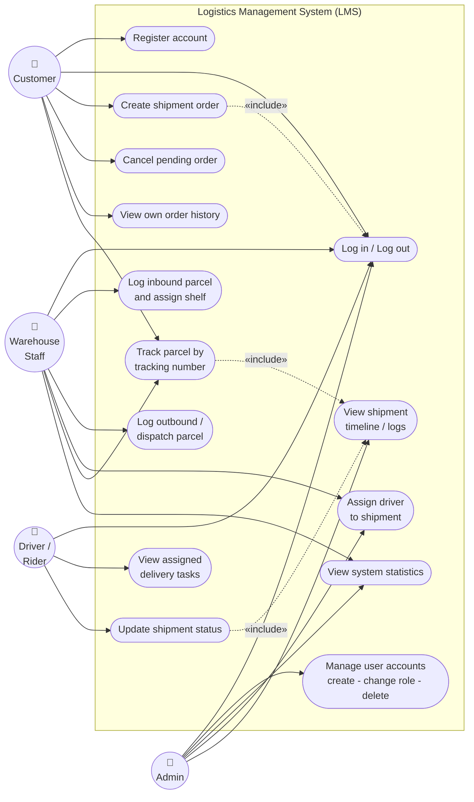

# LMS – Diagrams 

Both diagrams are written in [Mermaid](https://mermaid.js.org/) so they render on GitHub,
GitLab, VS Code (Markdown preview), Notion, Obsidian, and on <https://mermaid.live>
(paste the code block there and click *Actions → PNG/SVG* to export an image for Word).

---

## 1. Entity Relationship (ER) Diagram

Three tables: `users`, `shipments`, `logs`.

* One **user** (customer) can place **many shipments**.
* One **user** (driver) can be assigned **many shipments**.
* One **shipment** has **many log entries** (the tracking timeline).
* One **user** can appear in **many logs** as the person who made the change.

### Cardinality in words

| Relationship | Type | Meaning |
| --- | --- | --- |
| `USERS` → `SHIPMENTS` (customer_id) | 1 : N | a customer owns many shipments; each shipment belongs to exactly one customer |
| `USERS` → `SHIPMENTS` (driver_id) | 1 : N (optional, `ON DELETE SET NULL`) | a driver can be assigned many shipments; a shipment has 0 or 1 driver |
| `SHIPMENTS` → `LOGS` | 1 : N | every status change adds one log row |
| `USERS` → `LOGS` (updated_by) | 1 : N | each log row records who made the change |

---

## 2. Use Case Diagram

Actors: **Customer**, **Warehouse Staff**, **Driver/Rider**, **Admin**.
The dashed arrows are `«include»` relationships (the status update always also
writes a timeline entry).

### Use case descriptions 

| ID | Use case | Primary actor | Pre-condition | Main flow |
| --- | --- | --- | --- | --- |
| UC01 | Register account | Customer | not logged in | fill name/email/password → account created with role `customer` → redirected to login |
| UC02 | Log in / Log out | all | – | submit credentials → session created with role → logged in user is routed to their role dashboard; logout clears the session |
| UC03 | Create shipment order | Customer | logged in | fill sender/receiver/weight → system generates a unique tracking number → status `Pending` → log entry created |
| UC04 | Cancel pending order | Customer | own order, status `Pending` | click Cancel → status `Cancelled` → log entry created |
| UC05 | View own order history | Customer | logged in | system returns only shipments where `customer_id` = own id |
| UC06 | Track parcel | any (public) | tracking number | enter tracking number → shipment + full timeline displayed |
| UC07 | Log inbound parcel & assign shelf | Warehouse | shipment `Pending` | type shelf (e.g. `A-12`) → status `Warehouse Received`, `shelf_location` saved |
| UC08 | Log outbound / dispatch | Warehouse | status `Warehouse Received` | click Dispatch → status `In Transit` |
| UC09 | Assign driver | Warehouse, Admin | shipment not finished | pick a driver from the dropdown → `driver_id` saved → log entry |
| UC10 | View assigned delivery tasks | Driver | logged in | system returns only shipments where `driver_id` = own id |
| UC11 | Update shipment status | Driver | own assignment, legal next status | choose next status (In Transit / Out for Delivery / Delivered) → status saved + log written |
| UC12 | View shipment timeline | staff, admin, tracking | shipment exists | all `logs` rows for the shipment shown in order |
| UC13 | Manage user accounts | Admin | logged in as admin | create account / change role / delete account (blocked if the user owns shipments) |
| UC14 | View system statistics | Admin, Warehouse | logged in | total orders, active shipments, delivered, cancelled, users, per-status and per-role counts |

---

## 3. Role / permission matrix 

| Capability | Customer | Warehouse | Driver | Admin |
| --- | :--: | :--: | :--: | :--: |
| Register (self sign-up) | ✅ | – | – | – |
| Create order | ✅ | – | – | ✅ (on behalf of a customer) |
| View own orders / tasks | ✅ | – | ✅ | – |
| View all shipments | – | ✅ | – | ✅ |
| Log inbound + shelf | – | ✅ | – | ✅ |
| Dispatch (In Transit) | – | ✅ | ✅ (own) | ✅ |
| Out for Delivery / Delivered | – | – | ✅ (own) | ✅ |
| Assign driver | – | ✅ | – | ✅ |
| Cancel order | ✅ (Pending only) | ✅ | – | ✅ |
| Public tracking | ✅ | ✅ | ✅ | ✅ |
| Manage users | – | – | – | ✅ |
| Dashboard statistics | – | ✅ | – | ✅ |

These rules live in one place in `app.py`:

* `ALLOWED_TRANSITIONS` – which status may follow which status
* `ROLE_STATUS_PERMISSIONS` – which role may set which status
* `@login_required("role")` – which role may call which route
